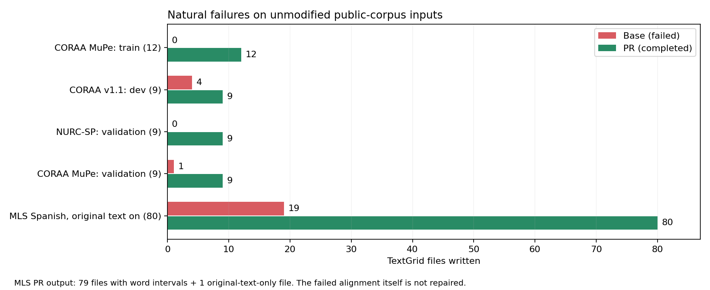
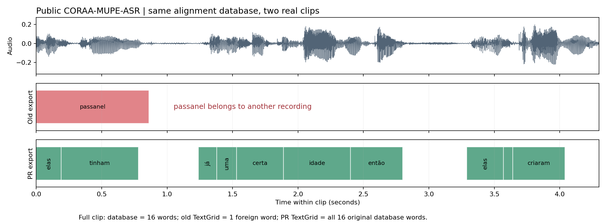
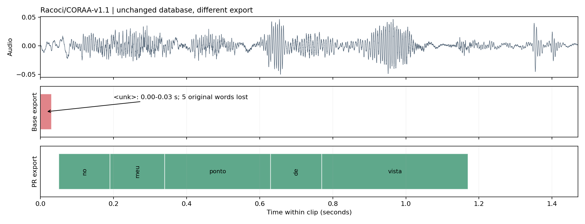
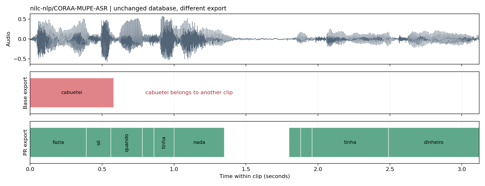
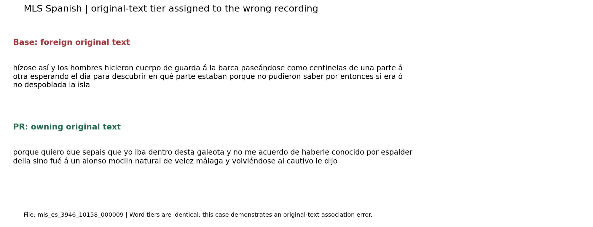

# Natural TextGrid export failures on public speech corpora

Validated on 2026-10-28 for PR #979.

The base exporter can write another recording's words into a TextGrid before
failing. This PR preserves the existing database intervals under their owning
file IDs and lets the remaining export complete. It does not change acoustic
alignment, infer missing words, or repair an utterance that has no alignment.

## Natural full-CLI reproductions

Each row below uses original public-corpus audio and the corpus-provided text.
No SQL rows were deleted or changed to manufacture a missing stream group.

| Dataset / split | Clips | Base CLI | PR CLI |
|---|---:|---|---|
| CORAA-MUPE-ASR / train | 12 | `KeyError`, 0 TextGrids | exit 0, 12 TextGrids |
| CORAA v1.1, SP2010 / dev | 9 | `AssertionError` after 4 TextGrids | exit 0, 9 TextGrids |
| CORAA-NURC-SP / original/validation | 9 | `KeyError`, 0 TextGrids | exit 0, 9 TextGrids |
| CORAA-MUPE-ASR / validation | 9 | `AssertionError` after 1 TextGrid | exit 0, 9 TextGrids |
| MLS Spanish, original-text tier enabled | 80 | `KeyError` after 19 TextGrids | exit 0, 80 TextGrids |

The MLS PR result contains 79 files with words and one original-text-only file:
that clip had already failed alignment in both runs. The other four rows do
**not** require `--include_original_text`.



The conversational subsets were selected to exercise the failure: the first
short out-of-vocabulary clips found in a scan, plus ordinary sentence controls.
They are not random samples or estimates of corpus-wide failure rates.
MuPe train scanned 1,800 rows and selected four targets plus eight controls;
the other subsets selected three targets plus six controls. Their scans covered
100 rows (v1.1), 1,700 (NURC-SP), and 400 (MuPe validation).

## Why this happens

In these Portuguese examples, a short OOV clip has word intervals, but its
`spn` phone rows are classified as `silence` and removed by normal cleanup.
The phone stream then skips that file while the word stream retains it.
The base exporter advances the two streams in lockstep without matching their
file IDs. It can assign the retained words to the next phone-bearing file.
Later, a speaker lookup or an interval clipped to the wrong file duration fails.

Phone type matters: other `spn` rows can be classified as `oov` and survive
cleanup. Merely containing an unknown word does not establish this condition.
The PR independently matches each stream to the current file ID.

## Case 1: a sentence loses all 16 words

MuPe train row 0 begins `elas tinham já uma certa idade então…`.
Its database contains 16 word intervals. In a two-file export from the unchanged
full-run database, the base exporter writes only `passanel`, 0.000–0.861 s,
borrowed from row 354. The PR writes all 16 owning word intervals.



This two-file illustration is separate from the 12-file CLI run, which fails
before saving its first TextGrid. [Evidence](cases/coraa_mupe_train.json),
[base TextGrid](cases/coraa_mupe_train_base.TextGrid),
[PR TextGrid](cases/coraa_mupe_train_pr.TextGrid).

## Case 2: silent corruption before an assertion

CORAA v1.1 dev row 0 has five database words: `no meu ponto de vista`.
The base export saves only `<unk>`, 0.000–0.030 s. The PR preserves all five
words and their database times. The natural word-only clips are rows 39
(`poxa`), 44 (`ah`), and 46 (`ah`). Four already-written TextGrids contain
different word tiers before the base run raises `AssertionError`.



[Evidence](cases/coraa_v11.json), [base TextGrid](cases/coraa_v11_base.TextGrid),
[PR TextGrid](cases/coraa_v11_pr.TextGrid).

## Case 3: another recording's word replaces ten words

MuPe validation row 8 begins `fazia só quando não tinha nada…` and has ten
database words. The base export replaces the entire tier with `cabuetei`,
0.000–0.581 s, from another clip. The PR preserves all ten owning intervals.
This mismatch occurs in the full export, without selecting a pair of files.



[Evidence](cases/mupe_validation.json),
[base TextGrid](cases/mupe_validation_base.TextGrid),
[PR TextGrid](cases/mupe_validation_pr.TextGrid).

## Other failure modes and controls

NURC-SP fails before writing a file, so there is no completed corrupted
TextGrid to display. Its natural word-only clips contain `Recitação.`, `Elegia.`,
and `Tangulomango.`. [Evidence](cases/nurc_sp.json).

In MLS Spanish, the word and phone tiers of written files match the database,
but three original-text tiers contain another file's full transcript before
the export crashes. [Example](cases/mls_original_text.json). The PR matches
the original text correctly and exports the remaining valid alignments.
This does not demonstrate a numerical one-word timing shift within a clip.



Negative controls: 130 official AMI ES2002a speech segments and 102 MLS clips
(Spanish 31, French 26, German 45) give identical parsed base/PR exports.
The MLS count comprises 72 initial clips and 30 additional high-OOV clips,
with no overlap. Every control was checked with cleanup on/off and the
original-text tier on/off. [Results](negative_controls.json).
In the English AMI configuration, `spn` for `Mm` is `oov` and survives cleanup.

## Method and practical limits

- Runtime: MFA package metadata 3.4.1; the exact selected export function was
  injected into every already-imported MFA alias in each child process.
- Base function: `93411fc0df3bc770dfd34c4282dc136fdf6e8dcb`.
  PR function: `8545fd38f47b81f8a1743c8c9f8ab7b323e853eb`.
- New CLI runs used one job, `--no_use_mp`, SQLite, no speaker adaptation,
  no tokenization, and long TextGrid output. Multiprocess export is untested here.
- Separate acoustic runs can vary slightly. Therefore, each conversational
  case was additionally exported with both functions from **one read-only
  SQLite database**. Its SHA-256 remained unchanged.
- On those same databases, cleanup on reproduces each failure; cleanup off
  makes the parsed base/PR results equal, with or without original text.
- All 302 word intervals from the four conversational PR exports match their
  respective databases. Maximum time difference is below one microsecond.
- No additional `<unk>` spans were synthesized. Standard-model hashes are in
  [models.json](models.json). The existing four export regression tests pass;
  the full project test suite was not run.

## Reproduce and source attribution

Public inputs and immutable dataset revisions/row IDs are recorded in each
case JSON. The original audio is downloadable from the linked datasets; audio
and full SQLite databases are not bundled in this PR.

- [CORAA-MUPE-ASR](https://huggingface.co/datasets/nilc-nlp/CORAA-MUPE-ASR)
  (NILC / Museu da Pessoa).
- [CORAA v1.1 mirror](https://huggingface.co/datasets/Racoci/CORAA-v1.1)
  and [CORAA project](https://github.com/nilc-nlp/CORAA), SP2010 source recordings.
- [CORAA-NURC-SP](https://huggingface.co/datasets/nilc-nlp/CORAA-NURC-SP-Audio-Corpus)
  (NILC / NURC-SP).
- [MLS, OpenSLR 94](https://www.openslr.org/94/) (Multilingual LibriSpeech).
- [AMI](https://groups.inf.ed.ac.uk/ami/download/) (AMI Consortium).

The portable runner, fresh public-input download, four same-database exports,
and actual function hashes were rechecked before publication:
[validation receipt](validation.json).

See [reproduce.py](reproduce.py) for a portable, traced comparison using an
existing WAV/LAB corpus and installed MFA models. Reproduction must replace
all imported aliases, not just `montreal_forced_aligner.textgrid`.

```bash
python reproduce.py prepare --case coraa_v11 --output /path/to/corpus
python reproduce.py run --repo /path/to/Montreal-Forced-Aligner \
  --corpus /path/to/corpus --dictionary /path/to/portuguese_brazil_mfa.dict \
  --acoustic-model /path/to/portuguese_mfa.zip --output /path/to/cli-results
python reproduce.py export --database /path/to/cli-results/base/scratch/corpus/corpus.db \
  --source /path/to/cli-results/base_textgrid.py --output /path/to/base-export
python reproduce.py export --database /path/to/cli-results/base/scratch/corpus/corpus.db \
  --source /path/to/cli-results/pr_textgrid.py --output /path/to/pr-export
```

`prepare` verifies the dataset revision, source path, transcript, and downloaded
media SHA-256 before writing each input. It fails explicitly if the current
Dataset Viewer revision differs; use the recorded immutable source revision
in that case. Pass `--no-cleanup` or `--include-original-text` to `export` for
additional controls. Use a fresh output directory for each command.

## Correction to the earlier Spanish CLI report

The earlier [Spanish two-clip report](../pr979_spanish/README.md) incorrectly
described four CLI runs as a base-versus-PR comparison. Its original wrapper
replaced only the textgrid-module attribute; already-imported alignment aliases
still referenced the old function. Those runs therefore do not validate a CLI
comparison. The earlier direct exporter tests and controlled database experiment
are unaffected. The report and reproduction wrapper are corrected in this update.
All new results above use verified alias replacement and call-time source traces.
